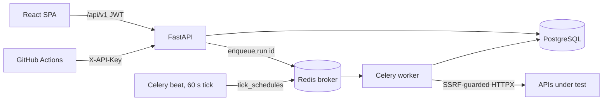
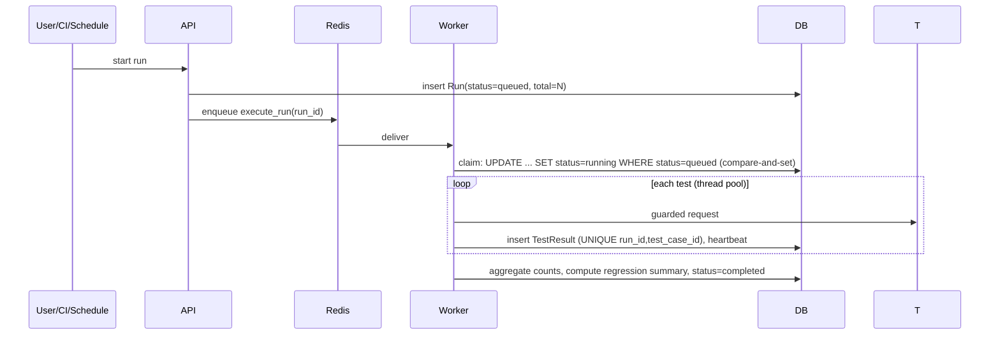

# Architecture

## Run lifecycle

## Layering (backend)
- `routers/` thin HTTP layer, auth + validation, unified error envelope.
- `services/engine.py` pure request executor (no DB). `assertions.py` pure evaluators. `ssrf.py` network guard.
- `services/runner.py` run state machine: claim, execute, resume, cancel, recover.
- `services/regression.py` pure comparison logic over result rows.
- `services/scheduler.py`, `dispatch.py`, `openapi_import.py`.
- `worker/` Celery app and tasks (`acks_late`, `reject_on_worker_lost`, prefetch 1).

## Execution modes
`celery` (production), `thread` (single-process dev default), `inline` (tests). Same runner code in all three.

## Crash safety
Delivery is at-least-once, so the runner is idempotent: atomic claim, `UNIQUE(run_id, test_case_id)`, a heartbeat lease so an orphaned `running` run can be re-claimed, and resume that skips tests that already have a result.
