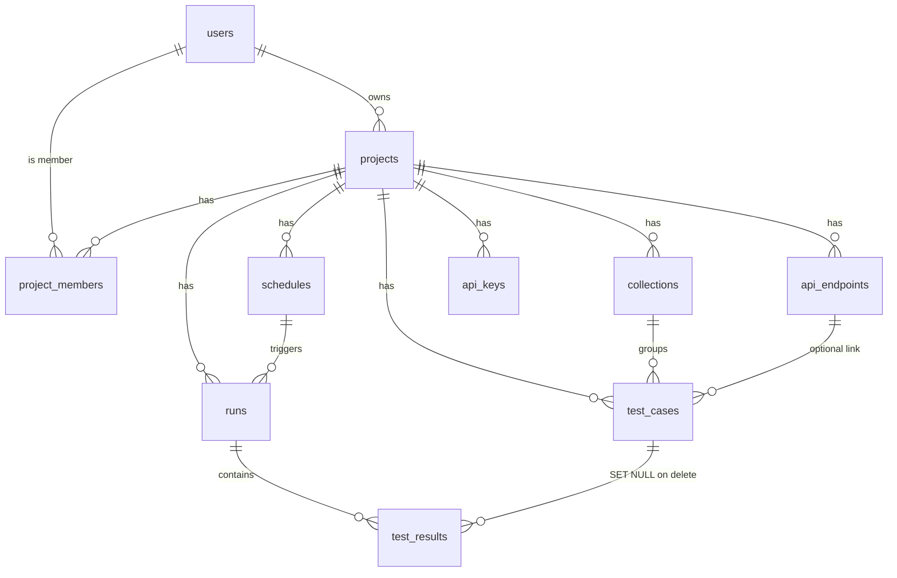

# Database Design

## Notes
- **Encrypted columns:** `EncryptedJSON` (Fernet) for `test_cases.auth_config` and `projects.variables`.
- **Timestamps:** `UTCDateTime` decorator returns timezone-aware UTC on every backend (SQLite drops tzinfo natively).
- **Results keep a snapshot** (name, method, url) so history survives test edits/deletes (`test_case_id` is `SET NULL`).
- **Integrity:** `UNIQUE(run_id, test_case_id)` on `test_results` prevents duplicate results under redelivery.
- **Cascades:** deleting a project removes everything under it.
- **API keys:** only a sha256 hash and a display prefix are stored.
- **Migrations:** Alembic `0001_initial_schema`; upgrade, downgrade, `alembic check` (no drift) verified on SQLite, and upgrade verified on PostgreSQL 16.
